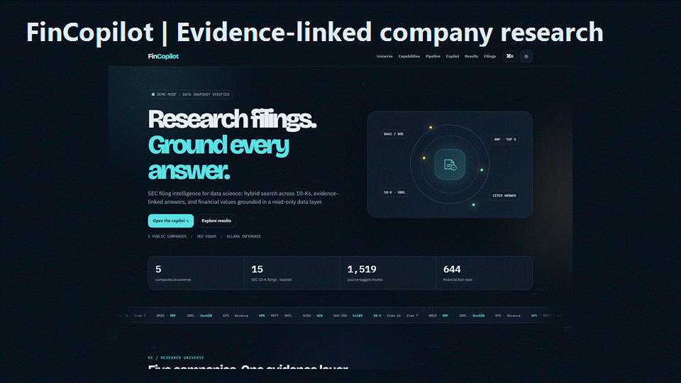
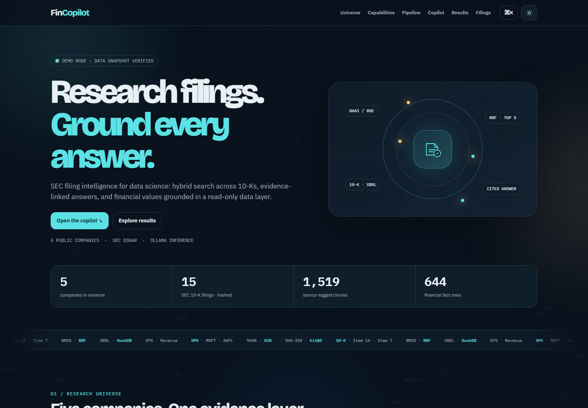
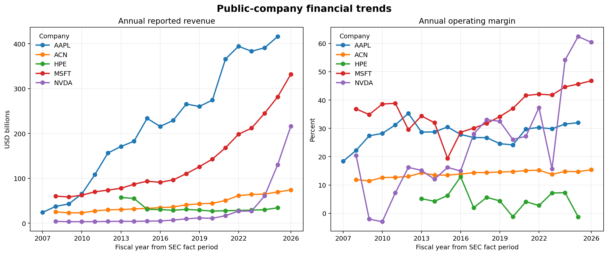
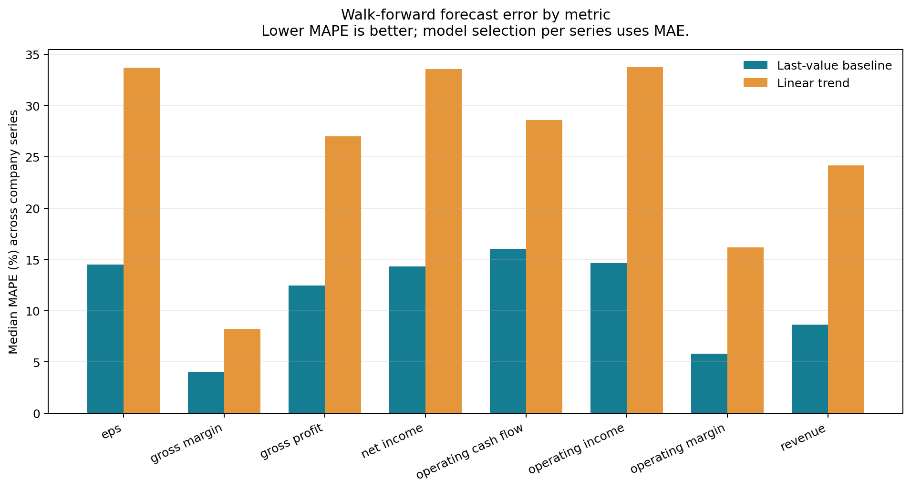
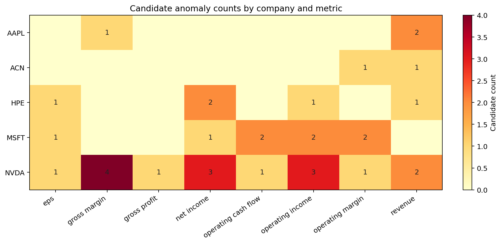

# FinCopilot

  <strong>Understand public-company filings with cited evidence and practical data science.</strong> 
  A finance research assistant for SEC filings, retrieval, analytics, and plain-language explanations.

  
  
  
  
  

  <a href="showcase.html">Interactive dashboard source</a> ·
  <a href="FinCopilot_Data_Science_Project_Report.docx">Detailed project report</a> ·
  <a href="report_render/FinCopilot_Data_Science_Project_Report.pdf">Report PDF</a>

## What this project does

FinCopilot helps readers explore annual reports for five public companies. It searches SEC 10-K filings, shows the passages behind its answers, and explains finance terms in everyday language. When a question needs a financial number, a read-only data tool supplies it from DuckDB.

The project covers data collection, text preparation, search, model-assisted answers, financial analytics, evaluation, and an interactive dashboard. Each stage can be inspected.

### Research universe

| Company | Ticker | Source |
|---|---:|---|
| Apple Inc. | AAPL | SEC EDGAR 10-K |
| Accenture plc | ACN | SEC EDGAR 10-K |
| Hewlett Packard Enterprise | HPE | SEC EDGAR 10-K |
| Microsoft Corporation | MSFT | SEC EDGAR 10-K |
| NVIDIA Corporation | NVDA | SEC EDGAR 10-K |

The current reproducible snapshot has 15 filings (three per company) and 1,519 source-tagged text chunks. Its manifest records report dates, accession numbers, file sizes, and SHA-256 hashes. Filings, chunks, and indexes are built locally and are not committed here.

## Explore the project

The dashboard includes the company universe, an eight-stage pipeline, plain-language copilot, charts, source manifest, and setup notes.

Charts generated from SEC XBRL company facts:

### Company trends

### Forecast baseline comparison

### Anomaly candidates

## How it works

~~~mermaid
flowchart LR
    A[SEC EDGAR filings and XBRL] --> B[Fetch and fingerprint]
    B --> C[Parse sections and chunk text]
    C --> D[BGE semantic search]
    C --> E[BM25 keyword search]
    D --> F[RRF ranking]
    E --> F
    F --> G[Cited filing passages]
    A --> H[DuckDB finance history]
    H --> I[Read-only financial tools]
    G --> J[Ollama plain-language answer]
    I --> J
    J --> K[FastAPI, Streamlit, dashboard]
~~~

1. **Collect:** download selected SEC 10-K filings and XBRL company facts.
2. **Fingerprint:** record each filing's accession, size, and SHA-256 digest.
3. **Prepare:** extract report sections and split them into overlapping, source-tagged chunks.
4. **Index:** create local BGE embeddings and a BM25 keyword index.
5. **Retrieve:** combine semantic and keyword rankings with reciprocal-rank fusion (RRF).
6. **Analyze:** store history, simple forecast baselines, and anomaly candidates in DuckDB.
7. **Answer:** give the configured Ollama model retrieved evidence and tool results; keep citations within the retrieved set.
8. **Serve:** expose chat and analytics through FastAPI, Streamlit, and the dashboard.

Keyword search is good at exact company terms and accounting labels. Semantic search can find related language when a question uses different words. RRF combines the ranked lists. The copilot shows evidence for review.

The analytics pipeline plots financial trends, compares last-value and linear-trend forecast baselines with rolling one-step-ahead error, and flags unusual observations with median absolute deviation (MAD). Flags are review prompts, not proof of an error. Forecasts are exploratory baselines, not promises or investment advice.

## Data and measured snapshot

These are project snapshot counts, not claims about complete or live financial histories.

| Item | Snapshot |
|---|---:|
| Companies | 5 |
| SEC 10-K filings | 15 |
| Source-tagged filing chunks | 1,519 |
| Historical and derived financial rows | 644 |
| One-year forecast rows | 36 |
| Anomaly candidates for review | 34 |

A preliminary retrieval smoke run used 40 answerable prompts with section-level seed labels:

| Search method | Hit@5 |
|---|---:|
| BM25 keyword | 0.825 |
| Dense semantic | 0.925 |
| Hybrid | 0.925 |

**Interpretation:** labels still need source checking; verified gold chunk IDs and reference answers are absent; this is not a held-out benchmark. Treat these figures as an early retrieval signal, not final performance. Citation validity, refusal quality, and answer quality still need systematic review.

## Run on Windows

### Requirements

- Windows 10 or 11, Python 3.11+, and Git
- [Ollama](https://ollama.com/download), installed and running
- Enough available memory for the chosen model and embedding index

The configuration defaults to a small local Qwen model. Speed depends on available memory and GPU hardware. Cloud models are supported after signing in to Ollama; availability depends on the account plan and usage limits.

### 1. Create the environment

~~~powershell
git clone https://github.com/Nithi-121/FinCopilot-Finance-Supply-Chain-Copilot.git
cd FinCopilot-Finance-Supply-Chain-Copilot
py -3.11 -m venv .venv
.\.venv\Scripts\Activate.ps1
python -m pip install --upgrade pip
pip install -e ".[dev]"
Copy-Item .env.example .env
~~~

If PowerShell blocks activation, run this in that terminal and activate again:

~~~powershell
Set-ExecutionPolicy -Scope Process -ExecutionPolicy Bypass
.\.venv\Scripts\Activate.ps1
~~~

### 2. Configure SEC contact and model

Open `.env` and set `SEC_USER_AGENT` to an app name plus a contact email:

~~~text
SEC_USER_AGENT=FinCopilot your.name@example.com
~~~

Use your own contact. SEC requests require an identifiable User-Agent. Keep `.env` private; Git ignores it.

For local inference, pull the configured model:

~~~powershell
ollama pull qwen2.5:1.5b
~~~

For cloud inference, sign in to Ollama yourself and set `OLLAMA_MODEL` in `.env` to an available model such as `gemma4:cloud`. Do not put credentials in browser code or commit them.

### 3. Download and build the data

Run from the project folder with `.venv` active. The first run downloads filings, financial facts, and the embedding model; it may need time and disk space.

~~~powershell
python -m src.fetch
python -m src.snapshot
python -m src.financial_data
python -m src.parse
python -m src.index
python -m src.eda
~~~

Raw filings, chunks, indexes, caches, and DuckDB stay on your computer and are ignored by Git. Inspect a sample of parsed chunks before relying on search.

### 4. Start services

Use separate PowerShell windows in the project folder.

**Window 1 — Ollama** (only if it is not already running):

~~~powershell
ollama serve
~~~

**Window 2 — API:**

~~~powershell
.\.venv\Scripts\Activate.ps1
python -m uvicorn api.main:app --host 127.0.0.1 --port 8000
~~~

**Window 3 — dashboard:**

~~~powershell
.\.venv\Scripts\Activate.ps1
python scripts/serve_showcase.py
~~~

Open:

~~~text
http://127.0.0.1:8502/showcase.html?api=http%3A%2F%2F127.0.0.1%3A8000
~~~

The dashboard server listens on your computer and serves only `showcase.html`. Do not replace it with a server that exposes the whole project folder. For a visual tour without the API, open `http://127.0.0.1:8502/showcase.html`.

The Streamlit UI can also be started with:

~~~powershell
.\.venv\Scripts\Activate.ps1
streamlit run app/chat.py
~~~

### 5. Check status

- Health: `http://127.0.0.1:8000/health`
- Dependencies: `http://127.0.0.1:8000/ready`
- API docs: `http://127.0.0.1:8000/docs`

Readiness checks the filing index, financial database, Ollama service, and configured model.

## Example questions

- “Explain revenue in simple words.”
- “What risks does Accenture discuss in its latest 10-K?”
- “How does Microsoft describe its cloud business?”
- “Compare the companies' revenue trends.”
- “What does this filing say about supply-chain risk?”
- “Show the evidence behind that answer.”

The model must not guess a financial number. If the data tool cannot verify it, check the connected data and cited filing.

## Evaluation

The harness supports hit@k, mean reciprocal rank (MRR), and BM25, dense, and hybrid comparisons. Verify each seed question against the SEC source, add exact gold chunk IDs, and keep a separate held-out set before reporting final scores.

~~~powershell
Copy-Item eval/questions.seed.jsonl eval/questions.jsonl
python -m eval.run_eval eval/questions.jsonl --ablation
pytest
ruff check .
~~~

A stronger evaluation should record the filing snapshot, data split, exact chunk labels, hit@5, MRR@5, citation validity, numeric checks, refusal performance, and human ratings for factual support and clarity.

## Project files

| Path | Purpose |
|---|---|
| `src/fetch.py` | Retrieve public filings |
| `src/snapshot.py` | Record source accessions and hashes |
| `src/parse.py` | Extract sections and create traceable chunks |
| `src/index.py` | Build the local Chroma and embedding index |
| `src/retrieve.py` | BM25, dense, and hybrid search |
| `src/financial_data.py` | Build finance history, forecast, and anomaly tables |
| `src/eda.py` | Generate charts and tables |
| `src/tools.py` | Read-only filing and financial tools |
| `src/agent.py`, `src/generate.py` | Route questions and write grounded responses |
| `api/main.py` | FastAPI chat, readiness, and analytics endpoints |
| `app/chat.py` | Streamlit chat |
| `showcase.html` | Interactive dashboard |
| `eval/` and `tests/` | Evaluation harness, prompts, and checks |
| `FinCopilot_Data_Science_Project_Report.docx` | Detailed build report and source listing |

## Data safety

- Public filings are used for research and learning. This project is not investment advice.
- SEC EDGAR is the authoritative source. Follow its access guidance and set a valid contact in the User-Agent.
- Keep `.env`, credentials, and local data private. Never commit keys or personal configuration.
- DuckDB finance queries are read-only. Forecasts and anomaly candidates need human review.
- Citations and software checks help inspection; they do not guarantee correctness.

## References

- [SEC EDGAR filings](https://www.sec.gov/edgar/search/)
- [SEC company facts API](https://www.sec.gov/edgar/sec-api-documentation)
- [Ollama documentation](https://docs.ollama.com/)
- [FastAPI documentation](https://fastapi.tiangolo.com/)
- [DuckDB documentation](https://duckdb.org/docs/)

---
FinCopilot | Finance and supply-chain filing research | Snapshot prepared October 2026
